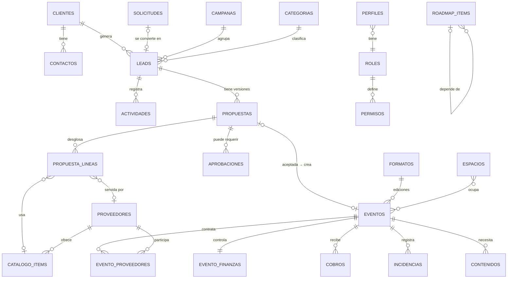

# THE GROOVE EXPERIENCE · Fase 1: Arquitectura

> Documento para aprobar antes de empezar el desarrollo.
> Stack: Next.js + Supabase + Vercel.

---

## 1. Principios

1. **Una sola fuente de verdad por dato.** Un cliente existe una vez. El lead es la oportunidad, no el cliente. El evento nace de la propuesta, no se vuelve a escribir.
2. **Autonomía + visibilidad.** Laura y Cristina operan sin pedir permiso. Groove ve todo en tiempo real. Solo se escala lo que rompe las condiciones estándar.
3. **Las reglas deciden la aprobación, no las personas.** El sistema compara la propuesta con las condiciones estándar configuradas y, si hay desviación, crea la solicitud de aprobación sola.
4. **Piezas transversales reutilizables.** Tareas, documentos, comentarios, actividad y aprobaciones funcionan igual en todos los módulos y se vinculan a cualquier entidad.
5. **Permisos configurables.** Los permisos se guardan como datos (rol × módulo × acción), no en el código, así que se pueden añadir usuarios o roles sin desarrollar.
6. **Los datos económicos van separados.** Los importes viven en tablas propias, lo que permite ocultarlos a perfiles sin acceso a finanzas (Rodri) usando RLS.

---

## 2. Arquitectura funcional

```
┌──────────────────────────── ENTRADA ────────────────────────────┐
│ Formulario web · Email (futuro) · Plataformas · Alta manual     │
│                        ↓                                        │
│                 BANDEJA DE SOLICITUDES                          │
│        (asignar a Laura/Cristina · descartar · convertir)       │
└────────────────────────────┬────────────────────────────────────┘
                             ↓
┌──────────────────────────── COMERCIAL ──────────────────────────┐
│ CLIENTES + CONTACTOS ←── LEADS (pipeline kanban) ──→ CAMPAÑAS    │
│                              ↓                    (Navidad Corp.)│
│                         PROPUESTAS (versiones + líneas)          │
│                              ↓ ¿fuera de condiciones?            │
│                         APROBACIONES (Rubén / Richy)             │
└────────────────────────────┬────────────────────────────────────┘
                             ↓ propuesta aceptada
┌──────────────────────────── OPERATIVA ──────────────────────────┐
│ EVENTOS ── proveedores asignados · timeline · incidencias        │
│    │       contenido (Rodri)                                     │
│    └── edición de un FORMATO PROPIO (opcional)                   │
│ CALENDARIO (vista unificada) · PROVEEDORES · CATÁLOGO/TARIFAS    │
└────────────────────────────┬────────────────────────────────────┘
                             ↓
┌──────────────────────────── CONTROL ────────────────────────────┐
│ FINANZAS (por evento + global) · REPORTING · DASHBOARD           │
│ ROADMAP 12 semanas · TAREAS transversales                        │
└─────────────────────────────────────────────────────────────────┘
   Transversal: Documentos · Comentarios · Actividad · Notificaciones
```

### Capas técnicas

| Capa | Responsabilidad |
|---|---|
| `app/(auth)` | Login con magic link |
| `app/(app)/<modulo>` | Pantallas por módulo (server components) |
| `lib/<modulo>/actions.ts` | Mutaciones (Server Actions), que vuelven a validar permisos |
| `lib/<modulo>/queries.ts` | Lecturas con el cliente Supabase del usuario (aplica RLS) |
| `supabase/migrations` | Esquema, RLS, triggers y vistas |
| `app/api/inbound/*` | Webhooks de entrada (formularios, email futuro) |
| Postgres triggers | Activity log, numeración de IDs, `requiere_aprobacion` |
| Postgres views | KPIs del dashboard, reporting, calendario unificado |

La seguridad real está en **RLS**. La interfaz solo oculta botones; aunque alguien llamase a la API directamente, la base de datos rechazaría lo que su rol no permite.

---

## 3. Módulos

| # | Módulo | Contenido | Notas |
|---|---|---|---|
| 1 | **Inicio** | KPIs, pipeline, próximos eventos, tareas urgentes, aprobaciones pendientes, actividad | Widgets según rol |
| 2 | **Solicitudes** (dentro de Leads) | Bandeja de entrada sin cualificar | Preparado para email |
| 3 | **Leads** | Kanban + tabla + ficha | Estados configurables |
| 4 | **Propuestas** | Versiones, líneas por bloque, condiciones, aprobación | PDF en fase 2 |
| 5 | **Eventos** | Ficha operativa, proveedores, timeline, incidencias, contenido | Se crea desde una propuesta |
| 6 | **Clientes** | Cuentas + contactos + histórico | Separado de leads |
| 7 | **Proveedores** | Ficha, servicios, tarifas, valoración, uso | Incluye hoteles e Inbodas |
| 8 | **Formatos propios** | Concepto + ediciones + resultados | Una edición es un evento |
| 9 | **Calendario** | Mes / semana / día, capas por tipo | Vista unificada |
| 10 | **Roadmap** | 12 semanas: lista, semana, responsable, área, timeline | |
| 11 | **Tareas** | Mis tareas / todas / por entidad | Transversal |
| 12 | **Documentos** | Repositorio por carpeta + vínculos | Supabase Storage |
| 13 | **Finanzas** | Por evento, mensual, previsión, variable | No es contabilidad |
| 14 | **Reporting** | Conversión, origen, categorías, ticket medio, pérdidas | Solo lectura |
| 15 | **Configuración** | Usuarios, roles/permisos, estados, categorías, condiciones estándar, catálogo | Admin |

### Decisiones para evitar duplicidades

- **Navidad Corporativa no es un módulo**: es una **Campaña**. Tiene leads etiquetados con la campaña, menús/tarifas en el **Catálogo** (proveedor Inbodas), hoteles en **Proveedores** (categoría hoteles) y una vista filtrada propia. Así, la próxima campaña (verano, San Valentín…) se crea sin desarrollar nada.
- **Groove Garden no es una categoría**: es un **Espacio**. Cualquier lead, propuesta o evento elige espacio(s): Sala principal, Groove Garden, etc.
- **Una edición de un formato propio = un evento** con `formato_id`. No hay una ficha de evento duplicada.
- **El calendario no guarda eventos ni reuniones**: los lee de su origen. Solo guarda lo que no tiene otra entidad (sesiones Groove, bloqueos, fechas no disponibles).
- **Reuniones y visitas = Actividades** del lead (tipo reunión o visita, con fecha), y aparecen solas en el calendario.
- **Contenido de Rodri = tabla `contenidos`** vinculada a un evento o formato (necesidad → en producción → producido → publicado, con enlaces y ficheros).

---

## 4. Modelo de datos

Esquema completo en [`02-modelo-datos.sql`](02-modelo-datos.sql). Resumen:

### 4.1 Núcleo de usuarios y permisos

| Tabla | Propósito |
|---|---|
| `perfiles` | 1:1 con `auth.users`. Nombre, avatar, `rol_id`, activo |
| `roles` | admin_tge, direccion, comunicacion… (editables) |
| `permisos` | `rol_id × modulo × accion` (ver, crear, editar, borrar, aprobar, ver_importes) |

### 4.2 Comercial

| Tabla | Campos clave |
|---|---|
| `solicitudes` | origen, canal, remitente, asunto, cuerpo, payload_raw, recibida_por, asignada_a, estado (nueva / asignada / convertida / descartada), lead_id |
| `clientes` | tipo (marca / empresa / agencia / particular / partner / comunidad), nombre, CIF, web, sector, preferencias, notas |
| `contactos` | cliente_id, nombre, cargo, email, teléfono, principal |
| `leads` | codigo (TGE-L-0001), fecha_entrada, cliente_id, contacto_id, origen, categoria_id, subcategoria_id, campana_id, fecha_prevista, asistentes, presupuesto_estimado, responsable_id, estado_id, prioridad, motivo_perdida, proxima_accion, fecha_proxima_accion, notas |
| `lead_espacios` | lead ↔ espacio (N:M) |
| `actividades` | lead_id/cliente_id, tipo (llamada, email, reunión, visita, nota, cambio de estado), fecha_inicio, fecha_fin, descripción, autor |
| `campanas` | nombre (Navidad Corporativa 2026), fechas, objetivo, activa |
| `estados_lead` | nombre, orden, color, es_ganado, es_perdido (configurables) |

### 4.3 Propuestas y aprobación

| Tabla | Campos clave |
|---|---|
| `propuestas` | codigo, lead_id, cliente_id, version, titulo, fecha_evento, asistentes, condiciones, estado, fecha_envio, fecha_validez, responsable_id, descuento_pct, requiere_aprobacion (calculado), motivos_aprobacion[] |
| `propuesta_lineas` | propuesta_id, bloque (espacio, catering, producción, decoración, técnica, personal, extras), catalogo_item_id, proveedor_id, descripción, cantidad, precio_unitario, coste_unitario |
| `propuesta_espacios` | propuesta ↔ espacio |
| `aprobaciones` | entidad_tipo, entidad_id, motivo, solicitada_por, estado (pendiente / aprobada / rechazada), decidida_por, fecha_decision, comentario |
| `condiciones_estandar` | regla (descuento_max_pct, margen_min_pct, precio_min_pax, importe_max_sin_aprobar…), valor, activa |

Los totales (precio, coste, margen) se calculan en una **vista** a partir de las líneas, nunca se escriben a mano. Así no hay importes desincronizados.

### 4.4 Operativa

| Tabla | Campos clave |
|---|---|
| `eventos` | codigo, nombre, propuesta_id, lead_id, cliente_id, formato_id, categoria_id, fecha, hora_inicio, hora_fin, montaje_inicio, desmontaje_fin, aforo, responsable_id, estado, notas_internas |
| `evento_espacios` | evento ↔ espacio |
| `evento_proveedores` | evento_id, proveedor_id, servicio, estado, contacto, importe_coste |
| `evento_timeline` | evento_id, hora, descripción, responsable |
| `incidencias` | evento_id, descripción, gravedad, estado, resuelta_por |
| `contenidos` | evento_id / formato_id, tipo (foto, vídeo, reel, post, nota de prensa), necesidad, estado, enlace, responsable |
| `formatos` | nombre, categoria_id, descripción, público, objetivo, duración, aforo, horario, necesidades, coste_estimado, ingreso_potencial, partners, sponsors |
| `proveedores` | categoria_proveedor_id, empresa, contacto, teléfono, email, web, servicios, condiciones, tipo (groove / propio), valoración 1-5, notas |
| `catalogo_items` | proveedor_id, nombre (Menú Navidad A), tipo (menú, servicio, tarifa espacio, hotel), precio_pax / precio_unidad, coste, condiciones, vigencia |
| `espacios` | Sala principal, Groove Garden, … |
| `calendario_bloques` | tipo (sesión Groove, bloqueo, no disponible), título, inicio, fin, espacio_id, notas |

### 4.5 Control

| Tabla | Campos clave |
|---|---|
| `evento_finanzas` | evento_id (1:1), facturación, costes, extras, cobrado, reserva_groove, variable_pct, variable_confirmado |
| `cobros` | evento_id, fecha, importe, concepto, estado |
| `roadmap_items` | semana (1-12), area, objetivo, titulo, responsable_id, colaborador_id, depende_de_id, fecha_inicio, fecha_limite, estado, prioridad, resultado_esperado |
| `tareas` | titulo, responsable_id, fecha, prioridad, estado, notas, entidad_tipo, entidad_id |

### 4.6 Transversal (polimórfico: `entidad_tipo` + `entidad_id`)

| Tabla | Uso |
|---|---|
| `documentos` | carpeta (comercial, dossiers, tarifas, contratos, proveedores, eventos, formatos, comunicación, legal, plantillas), nombre, storage_path, url_externa, subido_por |
| `documento_vinculos` | documento_id, entidad_tipo, entidad_id (un documento puede ir a varias entidades) |
| `comentarios` | entidad_tipo, entidad_id, autor, texto, menciones[] |
| `actividad_log` | entidad_tipo, entidad_id, accion, cambios (jsonb), usuario (lo rellenan triggers) |
| `notificaciones` | usuario_id, tipo, entidad, leída |

### 4.7 Taxonomía

`categorias`: árbol de dos niveles.

| Categoría | Subcategorías |
|---|---|
| Events & Brands | Corporate, Lanzamientos, Eventos de marca, Creator events, Beauty, Fashion, Presentaciones, Activaciones |
| Sport & Wellness | Fitness, Training, Cycling, Boxing, Yoga, Pilates, Wellness, Experiencias deportivas, Patrocinios |
| Social & Culture | Social Club, Brunch / Daytime, Family Edition, Talks, Música, Encuentros, Formatos propios recurrentes |

`categorias_proveedor`: catering, DJ, sonido, iluminación, mobiliario, decoración, fotografía, vídeo, seguridad, personal, actividades, entretenimiento, wellness, transporte, hoteles, producción.

---

## 5. Relaciones



Las entidades transversales (tareas, documentos, comentarios, actividad, aprobaciones) se pueden vincular a cualquiera de las anteriores mediante `entidad_tipo` + `entidad_id`.

**Cardinalidades clave**

- Un cliente puede tener muchos leads (oportunidades repetidas en el tiempo).
- Un lead puede tener muchas propuestas (versiones v1, v2…); como mucho una puede quedar `aceptada`.
- Una propuesta aceptada genera como mucho un evento.
- Un evento puede no tener propuesta (formato propio, evento interno).

---

## 6. Roles y permisos

### 6.1 Roles iniciales

| Usuario | Rol | Resumen |
|---|---|---|
| Laura | `admin_tge` | Todo, incluida la configuración |
| Cristina | `admin_tge` | Todo, incluida la configuración |
| Rubén | `direccion` | Ve todo, comenta, aprueba, no edita la operativa |
| Richy | `direccion` | Igual que Rubén, con el dashboard estratégico como inicio |
| Rodri | `comunicacion` | Eventos, calendario, formatos, documentos de comunicación y contenidos, sin importes |

Rubén y Richy comparten rol. Si más adelante necesitan permisos distintos, se crea `direccion_estrategica` desde Configuración, sin tocar código.

### 6.2 Matriz (V = ver, C = crear, E = editar, B = borrar, A = aprobar, $ = ver importes)

| Módulo | admin_tge | direccion | comunicacion |
|---|---|---|---|
| Inicio / Dashboard | V $ | V $ | V (sin KPIs económicos) |
| Solicitudes | V C E B | V C (*) | V C (*) |
| Leads | V C E B $ | V $ | — |
| Propuestas | V C E B $ | V $ | — |
| Aprobaciones | V C | V **A** | — |
| Eventos | V C E B $ | V $ | V |
| Contenidos | V C E B | V | V C E |
| Clientes | V C E B $ | V $ | — |
| Proveedores | V C E B $ | V $ | V (sin tarifas) |
| Formatos propios | V C E B $ | V $ | V |
| Calendario | V C E B | V | V |
| Roadmap | V C E B | V | V |
| Tareas | V C E B | V C (solo propias) | V C E (solo propias) |
| Documentos | V C E B (todas las carpetas) | V | V C E (Comunicación, Formatos, Eventos) |
| Finanzas | V C E $ | V $ | — |
| Reporting | V $ | V $ | — |
| Comentarios | V C (en todo) | V C (en todo) | V C (en lo que ve) |
| Configuración | V C E B | — | — |

(*) Cualquiera de Groove puede registrar una solicitud que le haya llegado y asignarla a Laura o Cristina en dos clics.

### 6.3 Implementación

- `permisos(rol_id, modulo, accion)` → función SQL `tiene_permiso(modulo, accion)` usada por todas las políticas RLS.
- Importes ocultos: los campos económicos viven en `evento_finanzas`, `cobros`, `propuesta_lineas` y `catalogo_items`, protegidos por `tiene_permiso(<modulo>, 'ver_importes')`.
- "Solo propias": política `responsable_id = auth.uid() or creado_por = auth.uid()`.
- Los usuarios se crean por invitación (Supabase Auth invite). No hay registro abierto.
- Todo cambio queda en `actividad_log` (quién, qué, cuándo, antes → después).

---

## 7. Navegación

```
SIDEBAR (oliva oscuro)                      TOPBAR
─────────────────────                       ──────────────────────────────────
THE GROOVE EXPERIENCE (Playfair)            🔍 Buscador global (⌘K)
                                            + Nuevo (lead, solicitud, tarea, evento)
Inicio                                      🔔 Aprobaciones y notificaciones
Leads           ▸ Pipeline · Lista ·        👤 Usuario
                  Solicitudes (n) ·
                  Campañas
Propuestas
Eventos
Clientes
Proveedores     ▸ Proveedores · Catálogo
Formatos propios
Calendario
Roadmap
Tareas
Documentos
Finanzas        (oculto a comunicacion)
Reporting       (oculto a comunicacion)
Configuración   (solo admin_tge)
```

**Patrones de interfaz**

- Listado → **drawer lateral** para vista rápida → página completa con pestañas (Resumen · Actividad · Propuestas · Tareas · Documentos · Comentarios).
- **Modales** solo para altas rápidas y confirmaciones.
- **Buscador global**: busca en clientes, contactos, leads, propuestas, eventos, proveedores y documentos (Postgres full-text + `pg_trgm`).
- **Filtros persistentes** por usuario: mes, responsable, categoría y estado.
- **Badges de estado** con colores de la paleta (sin saturar).

---

## 8. Flujo principal

```
SOLICITUD ──asignar──▶ LEAD (Nuevo)
                         │  actividades: llamada, email
                         ▼
                      Contactado ──▶ Reunión ──▶ Visita        (aparecen en el calendario)
                         ▼
                Propuesta en preparación  ── se crea PROPUESTA v1 (líneas desde el catálogo)
                         │
                         ├─ dentro de condiciones ─▶ Propuesta enviada
                         │
                         └─ fuera de condiciones ─▶ Pendiente aprobación Groove
                                                    │  APROBACION (Rubén / Richy)
                                                    ├─ aprobada ─▶ Propuesta enviada
                                                    └─ rechazada ─▶ vuelve a preparación (v2)
                         ▼
                      Negociación  (v2, v3… cada versión revalida las condiciones)
                         ▼
          ┌──────────────┼──────────────┐
      Confirmado       Perdido       Cancelado
          │           (motivo obligatorio → reporting)
          ▼
   "Convertir en evento" (1 clic)
   → EVENTO (Preproducción) hereda cliente, fecha, espacio, asistentes,
     líneas → servicios, proveedores → evento_proveedores,
     importe → evento_finanzas
   → genera tareas desde una plantilla (checklist operativo)
          ▼
   Preproducción → Producción → Confirmado → En ejecución → Finalizado
          ▼
   POSTEVENTO: cierre económico (cobrado / pendiente / variable confirmado),
   valoración de proveedores, contenido producido (Rodri),
   resultados, oportunidad futura en el cliente
```

**Reglas automáticas**

| Disparador | Efecto |
|---|---|
| Propuesta guardada | Recalcula `requiere_aprobacion` comparando con `condiciones_estandar` |
| Se pide enviar una propuesta que requiere aprobación | Se bloquea el envío, se crea una `aprobacion` y se notifica a dirección; el lead pasa a "Pendiente aprobación Groove" |
| Aprobación decidida | Notifica a la responsable y registra la decisión en la actividad |
| Propuesta aceptada | Lead → Confirmado, se ofrece crear el evento |
| Lead → Perdido | Pide el motivo de pérdida |
| Evento creado | Aparece en el calendario y se avisa si se solapa con una sesión Groove o un bloqueo |
| Evento → Finalizado | Crea las tareas de postevento |

**Motivos de aprobación** (configurables en Configuración):
descuento > X % · margen < Y % · precio/pax < tarifa mínima · importe > Z € · proveedor fuera de catálogo · condiciones modificadas · uso de espacio especial o fecha sensible · inversión extraordinaria.

---

## 9. Canal de entrada (preparado para el futuro)

- Tabla `solicitudes` con `canal` (web, email, plataforma, comercial, manual) y `payload_raw jsonb`.
- Endpoint `POST /api/inbound/form`: el formulario web inserta directamente (con token y rate limit).
- Endpoint `POST /api/inbound/email`: preparado para el inbound webhook de Postmark, Resend o Cloudflare Email Routing cuando exista `hola@thegrooveexperience…`. **Fuera del MVP.**
- Cualquier usuario de Groove puede crear una solicitud manual ("me ha llegado esto") y asignarla.
- Las solicitudes se deduplican por email del remitente contra los contactos existentes.

---

## 10. Diseño visual (tokens)

| Token | Hex | Uso |
|---|---|---|
| `--olive-deep` | #555A43 | Sidebar y navegación |
| `--olive` | #6F7458 | Botón principal, foco, enlaces activos |
| `--cream` | #EDE4D8 | Fondo general (nunca #FFF) |
| `--sand` | #D9C9B4 | Tarjetas y superficies |
| `--stone` | #C9BBA6 | Bordes, separadores, hover |
| `--espresso` | #2E2A26 | Texto |
| `--bronze` | #A3835B | Solo acentos: KPIs destacados, badges premium |

- Tipografía: **Playfair Display** (títulos y marca) + **Inter** (interfaz).
- Calendario (tonos apagados): sesión Groove = espresso · evento confirmado = olive · provisional/propuesta = sand con borde discontinuo · reunión/visita = stone · bloqueado = rayado gris cálido · formato propio = bronze.
- Diseño desktop-first y responsive. Mucho aire, radios suaves y sombras mínimas.

---

## 11. MVP y fases

### MVP (fase 2 del proyecto, unas 4-6 semanas)

Prioridad: **operar Navidad Corporativa ya** y dar visibilidad a Groove.

| Incluido | Alcance MVP |
|---|---|
| Auth + roles + RLS | 3 roles, invitación, matriz de permisos editable |
| Inicio | KPIs básicos, pipeline, próximos eventos, tareas, aprobaciones pendientes |
| Solicitudes | Alta manual + asignación (sin email) |
| Leads | Kanban + lista + ficha + actividades + campañas |
| Clientes + contactos | CRUD + histórico |
| Propuestas | Versiones, líneas, cálculo de margen, reglas de aprobación |
| Aprobaciones | Flujo completo con notificación en la app |
| Eventos | Conversión desde propuesta, ficha, proveedores, tareas |
| Calendario | Mes y semana, capas, bloques manuales e importación CSV del calendario 2026/27 |
| Proveedores + catálogo | CRUD, menús y precios de Inbodas, hoteles |
| Tareas | Transversales, mis tareas |
| Documentos | Subida y vínculos a entidades |
| Comentarios + actividad | En todas las fichas |
| Roadmap | Lista + vista por semana |
| Configuración | Usuarios, estados, categorías, condiciones estándar |

### Fase 3

- Finanzas completo (cobros, variable, previsión).
- Reporting de dirección.
- Formatos propios con ediciones y resultados.
- Contenidos (Rodri): flujo completo.
- Roadmap en timeline/Gantt.
- Vista día del calendario y detección de conflictos avanzada.
- Generación del PDF de la propuesta con la marca.
- Formulario web público → solicitudes.

### Fase 4

- Email entrante → solicitudes.
- Notificaciones por email o Slack.
- Plantillas de evento por formato.
- Sincronización con Google Calendar.
- Portal de cliente o firma de propuesta.

---

## 12. Riesgos

| Riesgo | Mitigación |
|---|---|
| Condiciones estándar sin definir → todo o nada se escala | Cerrar los valores antes del MVP (ver §13). Configurables. |
| Doble registro (Excel + app) | Importar los datos existentes en el arranque y usar la app como única fuente desde el día 1 |
| Solapamiento con sesiones Groove sin calendario cargado | Importar el calendario 2026/27 dentro del MVP |
| Variable o reserva Groove mal definidas | Definir la fórmula por escrito (ver §13) |
| Exceso de alcance retrasa Navidad | MVP centrado en el flujo comercial; el resto en fase 3 |
| Datos personales (particulares) | RGPD: base legal, borrado bajo petición y acceso restringido por RLS |
| Polimorfismo (`entidad_tipo`/`entidad_id`) sin FK real | Validación con trigger + índices; es un patrón estándar y aceptable a este volumen |

---

## 13. Decisiones que debemos cerrar

1. **Condiciones estándar**: valores de descuento máximo (%), margen mínimo (%), precio mínimo por pax por tipo de evento e importe a partir del cual se escala.
2. **Quién aprueba**: ¿basta con Rubén *o* Richy? ¿Hace falta alguno de los dos para ciertos motivos? (Propuesta: cualquiera de los dos; por encima de Z €, Richy.)
3. **Variable**: ¿sobre qué base (facturación, margen, neto tras la reserva Groove)? ¿Porcentaje fijo o por tramos? ¿Quién lo cobra (Laura y Cristina a partes iguales o según la responsable)?
4. **Reserva Groove**: ¿qué es exactamente? ¿Un fijo por uso del venue o un % de la facturación?
5. **Espacios**: lista cerrada de espacios reservables (Sala principal, Groove Garden, …) y aforos.
6. **Calendario 2026/27**: formato en el que lo tenéis (Excel, Google Calendar, PDF), para preparar el importador.
7. **Inbodas**: formato de los menús y precios (PDF, Excel), para cargarlos en el catálogo.
8. **Rubén y Richy**: ¿pueden editar algo de la operativa (por ejemplo, reasignar una solicitud) o solo comentar y aprobar?
9. **Dominio y email** de la marca (para Auth y el canal de entrada futuro).
10. **Cuentas**: crear el proyecto Supabase (región UE, Frankfurt) y el proyecto Vercel conectado a este repositorio. ¿A nombre de quién?

---

## 14. Siguiente paso

Cuando se apruebe este documento y se respondan los puntos de §13:

1. Scaffold de Next.js + Tailwind + shadcn con los tokens de la marca.
2. Migraciones de Supabase a partir de `02-modelo-datos.sql`, con datos semilla (roles, categorías, estados, usuarios).
3. Desarrollo por módulos en el orden del MVP.
